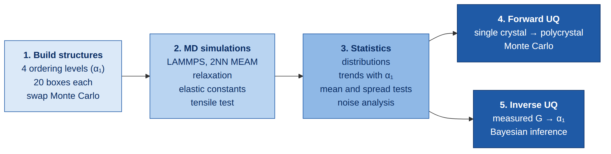

<div align="center">

# ti7al-sro

**Effect of Al short-range order on the stiffness and strength of Ti-7Al and estimating the order with Bayesian inference**

[](https://www.lammps.org)
[](https://www.python.org)
[](#note)

</div>

## Contents

- [The problem](#the-problem)
- [Main results](#main-results)
- [Key terms](#key-terms)
- [What was done](#what-was-done)
- [Results step by step](#results-step-by-step)
- [Limitations](#limitations)
- [How to reproduce](#how-to-reproduce)
- [Repository layout](#repository-layout)
- [References](#references)
- [Citation](#citation)
- [Contact](#contact)
- [Note](#note)

## The problem

Ti-7Al is titanium with 7% aluminium by weight (about 12 out of every 100 atoms are Al). It is used as a simple stand-in for Ti-6Al-4V, the titanium alloy used in jet engine fan and compressor parts.

In the crystal, Al atoms replace some of the Ti atoms. Computer simulations usually assume these Al atoms are scattered at random. In a real part they are not. When the alloy is heat treated (aged) at around 500 to 600 °C, the Al atoms slowly move so that they avoid sitting next to each other. This is called **short-range order (SRO)**. The crystal shape stays the same; only the pattern of which atom sits where changes.

So two parts made from the same alloy but heat treated differently can have different strength. This project asks:

1. How much does SRO change the stiffness and strength of Ti-7Al?
2. How much do these properties scatter, and why?
3. SRO is very hard to measure directly. Can we estimate it from a simple stiffness measurement instead?

## Main results

- Going from random Al to strongly ordered Al lowers the **yield strength by about 14%** and the **shear stiffness by 6 to 9%**. The resistance to uniform compression (bulk modulus) hardly changes.
- These changes are much bigger than the scatter between repeated simulations, so they are real.
- Young's modulus measured from a simulated tensile test is mostly noise. Calculating it from the elastic constants is about 7 times more precise.
- For a real part made of many grains, Young's modulus drops by about 6 to 7 GPa with ordering.
- If the shear modulus of a sample is measured accurately (within about 1%), a statistical model can tell how ordered the Al atoms are, and give an error bar.

## Key terms

| Term | Meaning |
|---|---|
| Molecular dynamics (MD) | A simulation that moves every atom according to the forces between atoms. Here run with the program LAMMPS. |
| Interatomic potential | The formula that gives the force between atoms. This project uses a published one for Ti–Al (2NN MEAM). |
| HCP | Hexagonal close-packed, the crystal structure of titanium at room temperature. Its long axis is called the **c-axis**. |
| Warren–Cowley parameter α₁ | A number that measures SRO. α₁ = 0 means random. Negative means Al atoms avoid each other. The lowest possible value here is -0.134. |
| Elastic constants (C₁₁, C₄₄, C₆₆, ...) | Stiffness of the crystal in different directions. A single crystal is not equally stiff in all directions. |
| Young's modulus E | Stiffness in tension (slope of the stress–strain curve). |
| Shear modulus G | Stiffness when the material is twisted or slid sideways. |
| Bulk modulus B | Stiffness when the material is squeezed equally from all sides. |
| Yield strength | The stress where the material stops behaving like a spring and starts to deform permanently. |
| Standard deviation (SD) | How much values spread around their average. |
| Polycrystal | A real metal part: many small crystals (grains) pointing in different directions. |
| Texture | How the grain directions are distributed in a part: all directions equally likely, or most grains pointing a certain way. |
| Monte Carlo | Repeating a calculation many times with random inputs to see how much the answer varies. |
| Bayesian inference | A way to work backwards from a measurement to its likely cause, with an error bar. |

## What was done

<p align="center">
  
</p>

1. **Build the crystals.** Four levels of order were chosen: α₁ = 0 (random), -0.04, -0.08 and -0.12 (strongly ordered). For each level, 20 simulation boxes of 4032 atoms (about 4 × 4 × 4 nm) were built. The boxes at one level have the same amount of order but different atom arrangements. Order was created by swapping pairs of Ti and Al atoms until α₁ reached the target.
2. **Run the simulations (LAMMPS).**
   - Relax each box at 300 K and zero pressure (5 ps at constant volume, then 50 ps at constant pressure).
   - Calculate the elastic constants at 0 K by stretching and shearing each box by ±0.5%.
   - Pull each box in tension at 300 K up to 15% strain to get the stress–strain curve.
3. **Analyse the numbers.** Compare averages and scatter between the four levels.
4. **Go from one crystal to a real part.** Average the crystal stiffness over many grain directions, and use Monte Carlo to see how the uncertainty carries over.
5. **Work backwards.** Build a Bayesian model that estimates α₁ from a measured stiffness.

Extra checks: three more strain rates, and 8 boxes eight times larger (32,256 atoms) to make sure box size does not change the results.

## Results step by step

### 1. Results at each level of order


_Figure 1_: Each coloured dot is one simulation box. The black dot is the average with its 95% confidence interval.

| Level | Yield strength (GPa) | Shear modulus G (GPa) |
|---|---|---|
| α₁ = 0 (random) | 6.90 ± 0.07 | 44.57 ± 0.11 |
| α₁ = -0.04 | 6.64 ± 0.06 | 43.97 ± 0.12 |
| α₁ = -0.08 | 6.30 ± 0.10 | 43.13 ± 0.08 |
| α₁ = -0.12 (ordered) | 5.95 ± 0.08 | 42.02 ± 0.09 |

Values are average ± SD of the 20 boxes. The simulated yield strength is much higher than in a lab test because the simulated crystals have no defects and are pulled extremely fast. What matters here is the change between levels, not the absolute value.

The scatter at each level follows a normal (bell-curve) distribution, which was checked with a standard statistical test.

### 2. How ordering changes the properties


_Figure 2_: All 80 boxes plotted against α₁, with a straight-line fit. Order increases to the right.

| Property | Change for every -0.1 in α₁ | How well the line fits (R², 1 = perfect) |
|---|---|---|
| Yield strength | -11.6% | 0.95 |
| C₆₆ (shear stiffness) | -7.4% | 0.98 |
| C₄₄ (shear stiffness) | -5.0% | 0.96 |
| G (shear modulus) | -4.8% | 0.97 |
| E from tensile test | -3.7% | 0.34 |
| B (bulk modulus) | +1.0% | 1.00 |

Ordering makes the alloy weaker and easier to shear, but not easier to compress.

Is this real or just chance? The boxes at one level scatter a little. The difference between random and strongly ordered is 12 to 27 times bigger than that scatter, and standard statistical tests (t-test and ANOVA) put the chance of this being luck at essentially zero.

### 3. Why the tensile-test modulus is noisy


_Figure 3_: (a) Young's modulus of the same boxes found in two ways. (b) The spread (SD) of each method.

In Figure 2, Young's modulus from the tensile test fits the line poorly (R² = 0.34). To find out why, E was calculated in two ways for every box:

- **Tensile test at 300 K.** The atoms vibrate with heat, so the stress reading jitters.
- **From the elastic constants at 0 K.** No heat, so no jitter. The only scatter left comes from where the Al atoms sit.

The tensile test contains both effects. Spreads add as squares (like errors in a lab report), so the jitter can be separated out:

noise² = 2.21² − 0.40², so noise ≈ 2.17 GPa (for the random alloy)

| Level | SD, tensile test (GPa) | SD, elastic constants (GPa) | Share of tensile scatter that is noise |
|---|---|---|---|
| α₁ = 0 | 2.21 | 0.40 | 97% |
| α₁ = -0.04 | 2.78 | 0.31 | 99% |
| α₁ = -0.08 | 2.39 | 0.33 | 98% |
| α₁ = -0.12 | 3.10 | 0.45 | 98% |

So almost all the scatter in the tensile-test modulus is heat noise. For the next steps, stiffness was taken from the elastic constants instead.

### 4. From one crystal to a real part


_Figure 4_: (a) Young's modulus of a real part with 95% error bars. (b) How much of the uncertainty comes from the crystal and how much from the texture. (c) Monte Carlo compared with a simple formula.

All simulations are of single crystals. A titanium crystal is stiffer along its c-axis (157 GPa) than across it (120 GPa). A real part has many grains pointing in different directions, so its stiffness is an average. No polycrystal was simulated. Instead:

1. The crystal's Young's modulus was calculated for 50 grain directions.
2. These were averaged, weighting each direction by how common it is in the part (the texture). Two textures were assumed: random (all directions equally common) and basal (most c-axes perpendicular to the load).
3. This was repeated 100,000 times (Monte Carlo). Each time, the elastic constants were changed slightly at random, matching the scatter of the 20 boxes, and the texture weights were changed by about 5%.

The average of the 100,000 results is the expected stiffness, and their spread is its uncertainty.

| Level | Texture | Young's modulus of the part (GPa) | Uncertainty coming from the crystal |
|---|---|---|---|
| α₁ = 0 | random | 118.15 ± 0.34 | 96% |
| α₁ = 0 | basal | 116.50 ± 0.37 | 99% |
| α₁ = -0.12 | random | 112.01 ± 0.24 | 90% |
| α₁ = -0.12 | basal | 109.18 ± 0.36 | 100% |

Ordering lowers the stiffness of the part by 6 to 7 GPa for both textures. Almost all of the uncertainty comes from the crystal, not from the texture.

The texture weights must always add up to 1. A simple formula that ignores this overestimates the uncertainty by 2 to 4 times (Figure 4c).

<details>
<summary>Try it yourself: a short Python version of this step</summary>

Paste into any online Python compiler. No extra libraries needed.

```python
import math
import random

# elastic constants of the random alloy (GPa): average and SD of the 20 boxes
mean = {"C11": 177.74, "C12": 93.57, "C13": 79.39, "C33": 203.88, "C44": 40.51}
sd   = {"C11": 0.16,   "C12": 0.20,  "C13": 0.15,  "C33": 0.12,   "C44": 0.16}


def E_direction(C, theta):
    """Young's modulus of an HCP crystal pulled at angle theta from its c-axis."""
    C11, C12, C13, C33, C44 = C["C11"], C["C12"], C["C13"], C["C33"], C["C44"]
    D = C33 * (C11 + C12) - 2 * C13 ** 2
    S11 = (C11 * C33 - C13 ** 2) / ((C11 - C12) * D)
    S13 = -C13 / D
    S33 = (C11 + C12) / D
    S44 = 1 / C44
    s, c = math.sin(theta), math.cos(theta)
    return 1 / (S11 * s**4 + S33 * c**4 + (2 * S13 + S44) * s**2 * c**2)


# 50 grain directions, random texture (all equally common)
N = 50
angles = [math.acos(1 - (i + 0.5) / N) for i in range(N)]
weights = [1 / N] * N


def part_E(C, w):
    return sum(wi * E_direction(C, a) for wi, a in zip(w, angles))


print("crystal, along c-axis :", round(E_direction(mean, 0), 1), "GPa")
print("crystal, across c-axis:", round(E_direction(mean, math.pi / 2), 1), "GPa")
print("part (one calculation):", round(part_E(mean, weights), 2), "GPa")

random.seed(1)
results = []
for run in range(20000):
    C = {k: random.gauss(mean[k], sd[k]) for k in mean}
    w = [wi * (1 + random.gauss(0, 0.05)) for wi in weights]
    total = sum(w)
    w = [wi / total for wi in w]          # weights add up to 1
    results.append(part_E(C, w))

m = sum(results) / len(results)
s = math.sqrt(sum((r - m) ** 2 for r in results) / (len(results) - 1))
print("part (Monte Carlo)    :", round(m, 2), "+/-", round(s, 2), "GPa")
```

Output:

```
crystal, along c-axis : 157.4 GPa
crystal, across c-axis: 120.1 GPa
part (one calculation): 118.16 GPa
part (Monte Carlo)    : 118.16 +/- 0.23 GPa
```

The spread here is a bit smaller than in the table (0.34 GPa) because this short version changes each elastic constant independently. The full analysis also accounts for how they change together.

</details>

### 5. Working backwards: how ordered is this sample?


_Figure 5_: (a) Shear modulus G against α₁, with the band where 90% of boxes fall. (b) Estimated α₁ for three measured values of G. (c) How the answer gets worse as the measurement gets less accurate. (d) Test on boxes the model had not seen.

Steps 1 to 4 go forward: given the order, predict the stiffness. In practice we usually know the stiffness (we can measure it) but not the order. The inverse model goes the other way.

How it works, in short:

- **Forward model:** the curve in Figure 5(a), fitted to the 80 boxes. It says what G to expect for each α₁.
- **Prior:** what we know before measuring. α₁ could be anywhere between -0.134 and +0.01.
- **Likelihood:** for every possible α₁, how well it explains the measured G, allowing for box scatter and measurement error.
- **Posterior:** combining the two gives the most likely range of α₁ (Figure 5b).

Example with G measured to within 1%:

| Measured G | Likely range of α₁ (90%) | Meaning |
|---|---|---|
| 44.5 GPa | -0.044 to +0.010 | random or nearly random |
| 43.3 GPa | -0.101 to -0.035 | partly ordered |
| 42.1 GPa | -0.134 to -0.095 | strongly ordered |

**How accurate must the measurement be?** G only changes by about 6% over the whole range of order (44.6 to 42.0 GPa). So the measurement error must be well below that. The table shows the width of the likely range of α₁ (smaller is better). Without any measurement the width is 0.13; this is the "prior only" line in Figure 5(c).

| Measurement used | No error | 1% error | 2% error |
|---|---|---|---|
| G | 0.016 | 0.073 | 0.109 |
| C₆₆ | 0.016 | 0.046 | 0.087 |
| Yield strength | 0.034 | 0.043 | 0.063 |
| G + C₄₄ + C₆₆ together | 0.014 | 0.035 | 0.068 |
| B | 0.004 | 0.127 | 0.129 |
| E from tensile test | 0.114 | 0.116 | 0.120 |

- At 1% error (±0.45 GPa) the model can still tell random, partly ordered and strongly ordered apart. At 2% the answer is vague, and at 5% it is no better than guessing.
- Ultrasonic testing can reach about 1%. A normal tensile test is not accurate enough.
- Using G, C₄₄ and C₆₆ together halves the range. B and the tensile-test E are not useful.
- **Does it work?** Each box was hidden in turn and its α₁ estimated from the other 79. The true value was inside the 90% range 85 to 90% of the time, so the error bars are honest.

### 6. Checks


_Figure 6_: Box size. Boxes eight times larger (open diamonds) give the same averages as the normal boxes (filled circles). Only the scatter depends on box size.

<p align="center">
  
  &nbsp;&nbsp;
  
</p>

_Figure 7_: (left) Yield strength at four pulling speeds. The ordered alloy is weaker at every speed. (right) Stress–strain curves, average of the 20 boxes at each level. The curves overlap at the start (similar stiffness) and separate at the peak (different strength).

## Limitations

- Only one interatomic potential was used. Compared with experiments, it gets C₆₆ right but overestimates some other elastic constants.
- Elastic constants were calculated at 0 K only.
- The order was created by swapping atoms to hit a target α₁, not by simulating real heat treatment.
- The textures were assumed, not measured, and the effect of grain boundaries is ignored.
- The inverse model has only been tested on simulated data, not on real samples yet.

## How to reproduce

### Requirements

- Python 3.8 or newer with NumPy, SciPy and Matplotlib (tested with Python 3.10, NumPy 2.2, SciPy 1.15, Matplotlib 3.10)
- LAMMPS with the MEAM package (only for Option 2)

```bash
git clone https://github.com/Jobayer90-cpu/ti7al-sro.git
cd ti7al-sro
pip install -r requirements.txt
```

### Option 1: redo the analysis (no LAMMPS, about one minute)

The simulation results are saved in `results/results.csv`, `results/tension.csv` and `results/cij.csv`. Everything else is calculated from these three files.

```bash
python python/7_analyze/analyze.py             # statistics and Monte Carlo
python python/7b_inverse/infer_alpha.py        # Bayesian inverse model
python python/8_figures/make_figures_clean.py  # figures
```

| Script | Creates in `results/` |
|---|---|
| `analyze.py` | `summary.csv`, `trend.csv`, `tests.csv`, `noise_check.csv`, `size_check.csv`, `uq_poly.csv` |
| `infer_alpha.py` | `inverse_variance.csv`, `inverse_identify.csv`, `inverse_loo.csv`, `inverse_examples.csv` |
| `make_figures_clean.py` | `figures_clean/fig1` to `fig8` |

The random seeds are fixed, so you get exactly the numbers shown above. Figure 7 (stress–strain curves) needs the raw LAMMPS output, so it is skipped unless you also run Option 2.

### Option 2: redo everything, including the simulations

This runs 88 relaxations and a few hundred mechanical tests, so it needs a computing cluster or a strong workstation.

```bash
python python/1_build/build_structures.py    # build the boxes and run folders in sims/
cd sims && bash run_relax_all.sh && cd ..    # LAMMPS: relaxation
python python/3_check_relax/check_relax.py   # check temperature, pressure and box size
python python/4_prepare_mech/prepare_mech.py
python python/4_prepare_mech/prepare_mech.py --batch B4_rate B5b_tension80 B5c_cij80
cd sims && bash run_mech_all.sh && cd ..     # LAMMPS: elastic constants and tension
python python/6_extract/extract_results.py   # creates results.csv, tension.csv, cij.csv
```

Then run Option 1. To try a single box first:

```bash
cd sims/disordered/B1_relax/box01
mpirun -np 4 lmp -in in.relax
```

## Repository layout

```
├── README.md
├── requirements.txt
├── workflow.png
├── potentials/                 interatomic potential files (library.meam, AlTi.meam)
├── templates/                  LAMMPS input files (relax, elastic constants, tension)
├── python/
│   ├── common/                 settings.py (folders, composition), sro.py (α₁ and atom swapping)
│   ├── 1_build/                build_structures.py
│   ├── 3_check_relax/          check_relax.py
│   ├── 4_prepare_mech/         prepare_mech.py
│   ├── 6_extract/              extract_results.py
│   ├── 7_analyze/              analyze.py
│   ├── 7b_inverse/             bayes_model.py, infer_alpha.py
│   └── 8_figures/              make_figures_clean.py
├── sims/                       run_relax_all.sh, run_mech_all.sh, run_batch.sh
└── results/
    ├── results.csv             one row per box: α₁ and all properties
    ├── tension.csv             all tensile tests
    ├── cij.csv                 elastic constants of every box
    └── figures_clean/          figures
```

The scripts expect exactly this layout. Folder paths are set in `python/common/settings.py`.

## References

1. Y.-K. Kim, H.-K. Kim, W.-S. Jung, B.-J. Lee, Atomistic modeling of the Ti–Al binary system, Comput. Mater. Sci. 119 (2016) 1–8. https://doi.org/10.1016/j.commatsci.2016.03.039
2. M.M. Billah, P. Acar, Design of polycrystalline metallic alloys under multi-scale uncertainty by connecting atomistic to meso-scale properties, Acta Mater. 270 (2024) 119879. https://doi.org/10.1016/j.actamat.2024.119879
3. R. Zhang et al., Direct imaging of short-range order and its impact on deformation in Ti-6Al, Sci. Adv. 5 (2019) eaax2799. https://doi.org/10.1126/sciadv.aax2799
4. A.P. Thompson et al., LAMMPS: a flexible simulation tool for particle-based materials modeling, Comput. Phys. Commun. 271 (2022) 108171. https://doi.org/10.1016/j.cpc.2021.108171

## Contact

Md Jobayer Aziz, md-jobayer.aziz1@louisiana.edu

## Note

- This project is ongoing.
- Claude (Anthropic) was used as an assistant for code development, data analysis, figure preparation and editing of the text. All simulations, results and conclusions were checked by the author.
